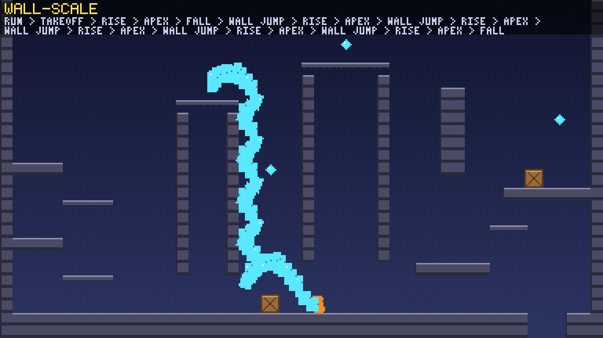
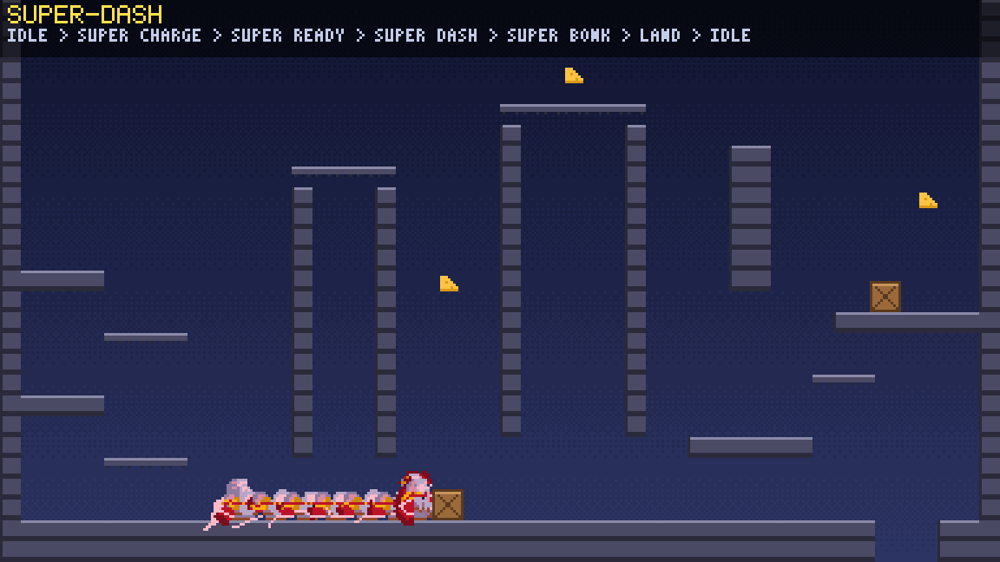
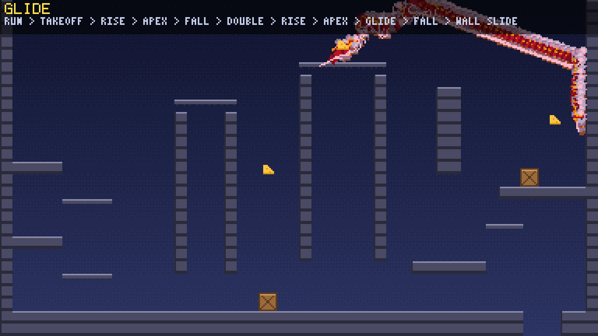
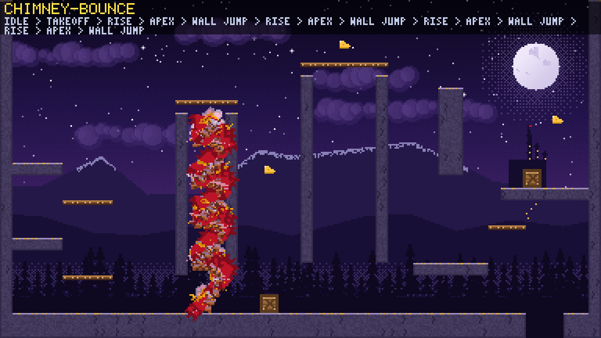
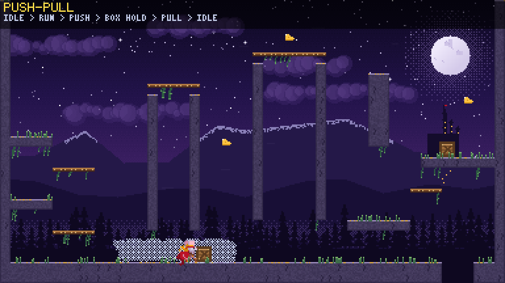

# game-toolkit-platformer

A pluggable platforming controller for [game-toolkit](https://github.com/sunsided/game-toolkit): fluid, snappy movement with presets tuned toward the feel of Celeste, Hollow Knight, Silksong and Super Meat Boy, and an animation state graph that follows it.



A character that feels good needs movement that is precise and forgiving, and animation that shows every one of its decisions without ever holding one up. This crate gives you both as one `Platformer`: pick a preset, feed it input, draw what it tells you. Underneath, the movement and the animation controller are separate layers you can tune, replace or use on their own.

## Quick start

```toml
[dependencies]
game-toolkit = "0.10"
game-toolkit-platformer = { git = "https://github.com/sunsided/game-toolkit-platformer" }
```

```rust
use game_toolkit::prelude::*;
use game_toolkit_platformer::prelude::*;

struct MyGame {
    level: Level,
    hero: Platformer,
}

impl Game for MyGame {
    fn init(_ctx: &mut Context) -> Result<Self> {
        let level = Level::demo();
        let hero = Platformer::on(&level, Preset::Precise);
        Ok(Self { level, hero })
    }

    fn update(&mut self, ctx: &mut Context, dt: f32) {
        self.hero.update(&ctx.input, &mut self.level, dt);
        for event in self.hero.drain_events() {
            match event {
                Event::Jumped { .. } => { /* a sound */ }
                Event::Landed { drop, .. } if drop > 48 => { /* a thud, some dust */ }
                _ => {}
            }
        }
    }

    fn render(&mut self, ctx: &mut Context, frame: &mut Frame) {
        let mut p = frame.painter(&mut ctx.gfx);
        p.clear([0.05, 0.04, 0.12, 1.0]);
        self.level.draw_debug(&mut p, [0.0, 0.0], 3.0);
        self.hero.draw_debug(&mut p, [0.0, 0.0], 3.0);
    }
}
```

That's a playable character (this code is also a doc test, so it compiles): keyboard and gamepad with the preset's own control scheme, the demo level, and a debug look (the level as blocks, the character as a box colored by animation state). The full version is `examples/minimal.rs`: `cargo run --example minimal`, F2 cycles the presets.

## Configuration

Everything goes through the builder:

```rust
# use game_toolkit_platformer::prelude::*;
# fn main() -> Result<(), Box<dyn std::error::Error>> {
let hero = Platformer::builder()
    .preset(Preset::Snappy)                // feel and controls
    .tune(|t| {                            // then adjust any number
        t.air_jumps = 2;
        t.dash_speed = 260.0;
    })
    .controls(Scheme::PRECISE)             // or another control scheme
    .spawn_at(40, 160)                     // or .spawn_on(&level), its `P`
    .respawn(false)                        // report falling out, don't reset
    .build()?;
# Ok(())
# }
```

| Preset | Feel | Tuned toward | Controls (keyboard / pad) |
|---|---|---|---|
| `Hybrid` | everything on | | Z jump, C dash, S super dash, D grab, down + A dive, Shift sprint / A, RT, LT, LB, down + B, X |
| `Precise` | precise and floaty: 8-way dash, climbing with stamina, no air jump | Celeste | C jump, X dash, Z grab / A, X, triggers |
| `Snappy` | hard jump cut, double jump, sideways dash, super dash, dive, slipping wall cling | Hollow Knight | as hybrid |
| `Drifter` | snappy, plus a glide after the double jump | Hollow Knight: Silksong | as hybrid |
| `Momentum` | walk or hold to run, momentum, strong wall jumps, wall stick | Super Meat Boy | Space jump, Shift run / A, X |

The presets lean toward each game's feel by ear; they are not measured copies. `Tuning` has every number and ability switch (about 80, each documented), and `set_preset` switches the feel at runtime.

## Your world

The character moves through anything that implements `Terrain`, and the only required method is `solid(rect)`, so a closure already counts:

```rust
# use game_toolkit_platformer::prelude::*;
let mut floor = |r: Rect| r.bottom() > 200;
let mut hero = Platformer::at(40, 100, Preset::Snappy);
hero.advance(Intent::default(), &mut floor, 1.0 / 60.0);
```

The other methods are optional: one-way platforms, dash refills, falling out of the world, a per-step `update` and `carry` for moving ground. `Level` is a ready-made `Terrain`: `Level::parse` takes ASCII rows (`#` solid, `=` one-way platform, `*` dash refill, `P` spawn), `Level::from_fn` builds one from your tilemap, and `Level::parse_with` adds tiles of your own (spikes, water, goals) that the movement treats as air. To add doors, lifts or boxes, wrap a terrain and name it as the `base`: you write only what changes ([moving platforms](docs/moving-platforms.md) is a recipe). With 16-pixel tiles, `Builder::scale(2)` lets your terrain speak pixels.

## Drawing your character

Each frame, draw sprite `hero.sprite()` at `hero.position()` (units, interpolated between the fixed steps), mirrored by `hero.facing()`. The sprite numbers are listed in `hero::sprite`: 78 poses from idle to super dash, so map them to cells of your sheet. `hero.state()` names the animation state, `drain_anim_events()` gives you its markers (`"step"` on each footstep) for sounds and dust.

To change the animation itself, pass your own graph with `.graph(spec)`; start from `hero::spec()`, the built-in one (36 states). The builder tells you if your graph lacks a parameter the movement drives.

## The moves

- jumping: a jump buffer, coyote time, variable height, a jump cut, hangtime at the apex, a heavier fall,
- in the air: a double jump, a glide, 8-way dashes with recharge, a dive,
- on walls: sliding, sticking, stick-aimed wall jumps that can scale a wall, climbing with stamina,
- on the ground: running and sprinting, rolls, hard landings, a charged super dash, drop-through platforms, looking up and down,
- in the demo, on the ability hooks: pushing and pulling boxes, a lift,
- details: corner correction, a skid when turning.

| | |
|---|---|
|  |  |
|  |  |

## Under the hood

| Module | What it does |
|---|---|
| `sim` | The movement: a fixed-step (120 Hz), deterministic body, an `Intent` in per step and `Event`s out. |
| `anim` | The animation controller, independent of any game: parameters (triggers that wait while a state is locked), clips with rates and markers, conditions, a validated graph, the `Animator`. |
| `hero` | The built-in character: its graph, sprite numbers, and the driver from movement to graph parameters. |
| `controls` | game-toolkit input to an `Intent`, through a `Scheme` per preset. |

With `default-features = false`, the crate drops game-toolkit and depends on nothing but std: use `sim` and `anim` in any engine. `docs/` describes the movement rules and the animation graph in detail, and how to add hazards, springs and checkpoints (`docs/hazards.md`).

## The demo

`demo/` is the test bench: the heroine of my game Cheesed as a cut-out puppet in a moonlit level, with an overlay for the animation state, slow motion and single steps, and headless filmstrips of every move (the pictures above).

```sh
task run          # the demo
task minimal      # the minimal example
task test         # all tests, doc examples included
task check        # fmt + clippy, with and without game-toolkit
```

You'll need Rust 1.95 or newer and [go-task](https://taskfile.dev) (or plain `cargo`).

## Current limitations

- Graphs and tunings are written in code; loading them from files (and hot-reloading) is next.
- A sprite sheet adapter (sprite numbers to Aseprite tags) isn't there yet; `draw_debug` and the demo's puppet are the two looks so far.
- No attack move, no camera.

## License

EUPL-1.2.

This is an independent project, not affiliated with or endorsed by the makers of the games it mentions for comparison; their names belong to their owners.
