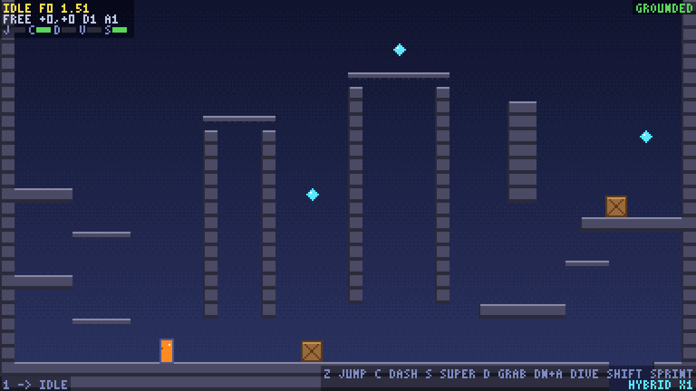

# animation

A small retro platformer that exists to grow a pluggable, configurable animation controller.


A character controller that feels as good as the ones in Hollow Knight, Celeste or Super Meat Boy is really two systems: movement that is precise and forgiving, and animation that shows every one of its decisions without ever holding one up. The first part is well documented by now; the second usually ends up as a pile of conditionals in the player script. This repository tries the other way around: the animation is a state graph made of named parameters, clips, conditions and priorities, compiled and validated, and run by an animator that doesn't know what it animates. The game around it is the test bench, and its hero combines moves from all three games so the controller has enough to animate.

It is written in Rust on [game-toolkit](https://github.com/sunsided/game-toolkit) and borrows its technical setup from my artillery game Starscorcher: a deterministic simulation free of toolkit types, a 384x216 pixel grid drawn through one `Raster` trait, and the toolkit only in the app module. There is no art yet: the hero is a placeholder block that squashes, stretches and tilts into one pose per sprite number, which is enough to tell every state and frame apart.

## The moves

Everything the movement can do, each tunable and each animated:

- jumping: a jump buffer (press before landing, jump on the first frame you can), coyote time, a variable jump height, a jump cut on release, hangtime at the apex, and a heavier fall,
- in the air: a double jump (with wings in the Hollow Knight preset), a glide after it (Silksong's Drifter's Cloak), 8-way dashes with recharge from the ground, walls or crystals, and a dive,
- on walls: sliding, sticking, stick-aimed wall jumps that can scale a single wall, and climbing with stamina and a grip that holds firm or slips,
- on the ground: running and sprinting, rolling out of high landings or out of a sprint, hard landings, the Crystal Heart super dash, dropping through one-way platforms, and looking up and down,
- with boxes: pushing and pulling, with static friction so they feel heavy (a box rumbles while it hasn't budged yet),
- details: corner correction, a skid when turning around, and an idle fidget after standing still for a few seconds.

| | |
|---|---|
|  |  |
|  |  |

The pictures are filmstrips (`task snapshot`): a scripted move played headless, the hero drawn every few steps, and the animation states it went through as the caption.

## Playing

```sh
task run
```

Movement is the arrows, the left stick or the d-pad. The buttons follow the feel preset you're playing, and F2 switches both at once (the overlay's bottom-right corner always shows the current keys):

| Action | Hollow Knight-like, Silksong-like, hybrid | Celeste-like | Meat Boy-like |
|---|---|---|---|
| jump (hold for height) | Z, Space / A | C, Space / A, Y | Space, Z / A |
| dash | C / RT | X / X, B | |
| super dash (hold, release) | S / LT | | |
| grab (hold) | D / LB | Z / RT, LT, RB, LB | |
| dive | down + A / down + B, down + RB | | |
| sprint / run (hold) | Shift / X | | Shift, X / X, RT |

Keyboard / gamepad, with Xbox button names. Hollow Knight's own slots are kept where it has the move (dash on RT, super dash on LT, the dive as down + cast like Desolate Dive); grab, which Hollow Knight doesn't have, goes to D and LB. Triggers work whether the pad reports them as buttons or only as an analog axis.

### How to

- **Jump higher, float longer:** hold jump; keep holding over the top to hang a little. Let go early for a short hop.
- **Queued jump and coyote time:** press jump a moment before landing and the hero jumps the instant it touches down; a moment after running off a ledge still counts as on the ground.
- **Double jump:** jump again in the air. A wall gives it back.
- **Run and sprint:** moving is running. Hold sprint for a higher top speed (hybrid); in the Meat Boy preset you walk, and hold the button to run, as in Super Meat Boy. The extra speed carries into jumps.
- **Roll:** drop from 6 tiles (48 px) or more and keep holding left or right as you land, or tap down while sprinting. Jump during the roll to keep its speed. The tower on the left and the chimney lids are high enough.
- **Hard landing:** drop from 12 tiles (96 px) or more without holding a direction. A jump pressed just before landing skips both the roll and the hard landing.
- **Glide** (hybrid, Silksong-like): press jump in the air and keep holding it. The press spends the double jump first if one is left; once falling, the cloak opens and the fall slows to a drift.
- **Dash:** with a direction (eight ways, up and down included) or without one (the way you face). The ground, a wall (not in Celeste) or a crystal gives it back.
- **Wall jump:** hold toward a wall while falling to slide, then jump. The stick aims it: toward the wall kicks you back onto it higher up (repeat to climb a wall; the chimneys are there for that), away leaps off, and up and down tilt the jump.
- **Climb:** hold grab against a wall; up and down climb until the stamina runs out, and climbing past the top hops over. A tired grip slips.
- **Dive:** down + dive in the air: a short hang, then straight down.
- **Super dash** (hybrid, Hollow Knight-like): hold the button standing, or while sliding down or holding on to a wall, until the hero flashes (0.8 s), then let go. The hero flies straight and level, over gaps, away from the wall it charged on, until a wall stops it. Jump or the button again cancels the flight; letting go early or jumping cancels the charge.
- **Drop through:** down + jump on a thin platform.
- **Push and pull:** walk into a box to push it; hold grab facing it and walk away to pull it.
- **Look up and down:** hold up or down while standing still.

## Feel presets

All the movement numbers and ability switches live in one `Tuning` struct, and the presets set it to lean toward one game each. They are approximations by feel, not measured copies, and a few of the rules (walls giving back the double jump, for one) are my own choices rather than verified behavior.

| Preset | What it's like |
|---|---|
| hybrid (default) | everything on, Celeste-like numbers with Hollow Knight's heavier fall and jump cut |
| celeste-like | precise and floaty: 8-way dash, climbing with stamina, no air jump, no jump cut, no dive |
| hollow-knight-like | snappy: instant run, hard jump cut, a double jump with wings, sideways dash, super dash, wall cling that slips, dive, hard landings |
| silksong-like | Hollow Knight's feel with a glide after the double jump, and no dive |
| meat-boy-like | walk or hold to run, momentum, strong wall jumps, wall stick, and nothing else |

## The controller, in a few lines

The animation side is its own module (`src/anim/`) and knows nothing about the game. A graph is written by name, compiled into a validated graph of ids, and run by an `Animator`; each step, a driver writes the parameters from whatever it is animating:

```rust
let graph = GraphSpec::new()
    .float("speed")
    .trigger("jump", 0.05)
    .state(StateSpec::new("idle", Clip::uniform(Playback::PingPong, &[0, 1], 0.5)))
    .state(
        StateSpec::new("run", Clip::uniform(Playback::Loop, &[2, 3, 4, 5], 0.08).marker(0, "step"))
            .rate_by("speed", 90.0, 0.4, 1.6),
    )
    .state(StateSpec::new("takeoff", Clip::uniform(Playback::Once, &[7], 0.06)).then("idle"))
    .transition(TransitionSpec::new(["idle"], "run", Cond::Above("speed".into(), 10.0)))
    .transition(TransitionSpec::new(["run"], "idle", Cond::Below("speed".into(), 10.0)))
    .transition(
        TransitionSpec::any("takeoff", Cond::Trigger("jump".into()))
            .priority(70)
            .breaks_lock(),
    )
    .compile()?;

let mut animator = Animator::new(Arc::new(graph));
```

Beyond a plain state machine, the controller provides:

- Triggers have a time to live. An event fired while a state is locked out (a flip that must finish, a hard landing) isn't lost; it waits until a transition consumes it or its time runs out. This is input queueing on the animation side.
- States can lock, transitions have priorities. A state can refuse all but lock-breaking transitions for a while, and transitions are tried highest priority first, so a dive impact always beats a landing.
- Clips have rates and markers. The run cycle plays at a rate scaled by the speed, climbing stops when the hero does, and named markers (`"step"`) come out as events for sound and dust.
- Specs are validated. Unknown states, duplicate names and a parameter used as the wrong kind (a float tested as a trigger) fail at compile time, not on the first frame that happens to need them.
- Names are `Cow<'static, str>`. A graph written in code borrows its names for free; one built from data owns them.

The hero's own graph (`src/hero/graph.rs`) has 36 states, and the pattern holds throughout: events (jump, land, dash) enter states through triggers, continuous facts (running, climbing, gliding) keep or leave them through bools and floats.

## Seeing what it does

Most of the tooling exists to inspect the animation:



- The overlay (F1: compact, full, off) shows the current state, frame and lock, the body's mode and speed, timer bars for the jump buffer, coyote time, dash buffer, variable jump and stamina, every active parameter and pending trigger, and the last few events.
- The clock: P pauses, `.` steps a single 1/120 s frame, `[` and `]` go from 1/16 to double speed, `\` resets. Presses made between steps are held over, so even slow motion never drops one.
- Filmstrips: `task snapshot` plays every scripted move headless and writes the PNGs above into `snapshots/` (`task snapshot -- roll glide` for just some).
- Determinism: the simulation and the animator advance in the same fixed step, so a cloned world plays out frame for frame identically (there's a test for that).

## Building

```sh
task run          # play
task test         # movement rules, determinism, controller, hero graph
task snapshot     # filmstrips of every scripted move into snapshots/
task screenshot   # the real window after 2 s, into screenshots/
task check        # fmt + clippy, warnings as errors (docs required everywhere)
```

You'll need a Rust toolchain of 1.95 or newer and [go-task](https://taskfile.dev); plain `cargo run` works too.

## Current limitations

- No art: placeholder poses, no sound, a single screen without a camera.
- Graphs and tunings are written in code; loading them from files (and hot-reloading while playing) is next.
- Silksong's own button layout isn't modeled; its preset borrows Hollow Knight's.

The design notes are in [docs/](docs/vision.md), starting with the vision, the movement rules and the animation graph, and the roadmap tracks what's next.

## License

EUPL-1.2, as declared in `Cargo.toml`.
